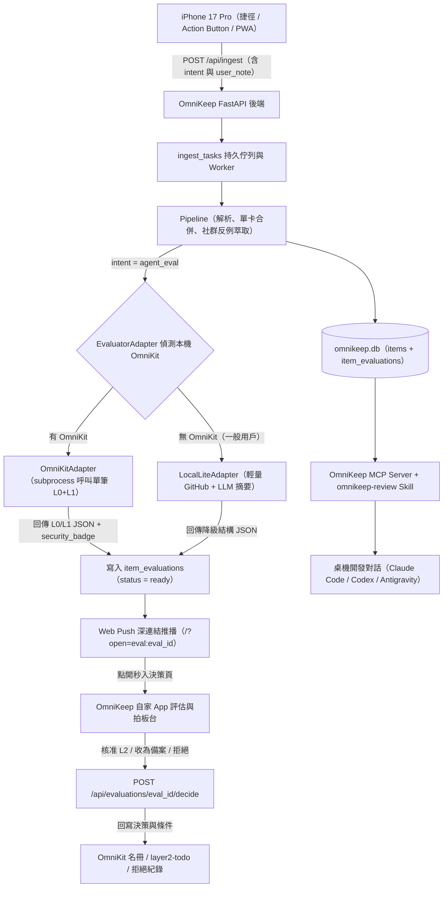
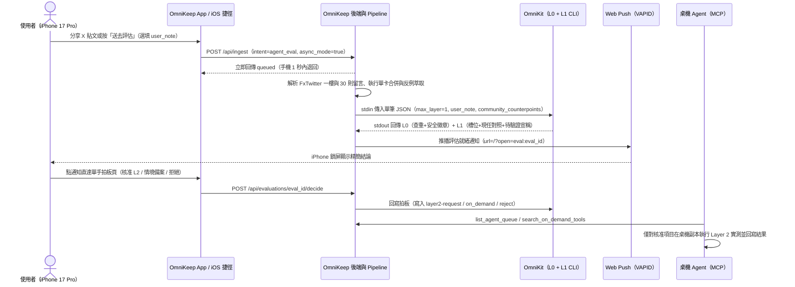

# 手機端 OmniKeep App × OmniKit 工具評估閉環設計與串接規格書

日期：2026-11-23　狀態：已定案（Layer 3 唯讀自動預研、iPhone 17 Pro 兩段式自家 App、OmniKeep × OmniKit 鬆耦合對接、第一版打穿軌 A 並預留 3 軌），待過目後啟動 P1 實作

---

## 1. 問題背景與真實案例實證

當使用者在手機（iPhone 17 Pro）滑到一篇介紹新工具或架構的貼文時，核心需求不是單純「以後再讀（Read It Later）」，而是：**初步判斷這個項目可能可以給自己的 Agent 參考、進一步優化現有工作流**，希望一鍵丟給系統在背景完成查證、與現有工具比對、檢視社群實測限制，最後在 OmniKeep 自家 App 看簡潔結論並單手拍板。

### 1.1 真實案例實證（2026-11-23 實測）

- **案例來源**：X 貼文 `https://x.com/mingzi206/status/2124437302068011026`，作者推薦開源專案 `EL4CTEO/fast-anything`，並將倉庫連結與安裝命令放在作者一樓。
- **抓取能力實測**：透過 `app/parsers/x_posts.py` 的 `parse_x_post` 呼叫 FxTwitter API v2，實測可完整抓取正文、引用貼文、作者一樓（`https://github.com/EL4CTEO/fast-anything`、npm/cargo 與 Claude Code plugin/MCP 指令）以及下方 30 則社群留言。
- **本機 `omnikeep.db` 現況實證**（2026-11-23T01:00Z 存入）：
  - 這則貼文目前在 Inbox 分裂成兩張彼此獨立的未讀卡片：
    1. `123ff88ca810`（X 貼文，分類 `開源專案`）
    2. 19 秒後由 Entity Fan-out 背景產生的 `95782854cac4`（GitHub repo，分類 `Github`），兩者透過 `item_citations` 紀錄 `cit_c44b0f3bb2` 連結。
  - 兩張卡都沒有區分「只是看看」或「給 Agent 評估」，使用者也沒有明確的拍板台或推播深連結可處理後續動作。

### 1.2 現況 5 大斷點

| 斷點類別 | 程式碼證據 | 實際問題說明 |
|---|---|---|
| 1. 意圖遺失與 Prompt 漏接 | `app/bot/telegram_bot.py:963-973`、`app/pipeline.py:672-678`、`app/pipeline.py:746`、`app/pipeline.py:927-950`、`app/pipeline.py:1018-1019`、`app/routers/ingest.py:15-26`、`app/database.py:60-78`、`frontend/src/components/reader/AnalysisTab.vue` | Bot 雖會把附註編進 `#note=`，`run_pipeline` 亦於 `673-677` 拆出 `user_note`，但**只有擋爬 fallback 分支（`746` 行）把 `user_note` 放入 LLM prompt**；所有正常分析分支（`770-950` 行）皆未注入 `user_note`，分析完才在 `1018-1019` 行貼回 `content_raw` 開頭。`/api/ingest` 與 `items` 表皆無 `user_note`、`intent`、`agent_status` 欄位；閱讀器 `AnalysisTab.vue` 也不顯示 `user_note`。 |
| 2. 卡片分裂與上下文斷裂 | `app/pipeline.py:540`、`app/pipeline.py:1070-1123`、`app/bot/telegram_bot.py:717-736` | Entity Fan-out 會在 `540` 行重跑完整 `run_pipeline(..., is_sub_task=True)` 並在 Inbox 裂出第二張未讀卡；子卡不繼承父卡 `user_note`，完成後也不會通知；Telegram 卡片附帶按鈕只把使用者導出到外部 GitHub 網頁，與評估閉環無關。 |
| 3. 專案監看脫鉤 | `app/radar/scheduler.py:275-282`、`app/watch/relevance.py:68-86` | `maybe_propose_for_item` 僅在雷達排程內呼叫，手動收藏不會觸發；且 `relevance.py` 僅比對有程式碼指紋之專案的 `tech_tags` 重疊（至少 `MIN_TAG_OVERLAP` 個），不理解個人 Agent 工作流、槽位與現任工具替代關係。 |
| 4. MCP 被動黑洞與截斷 | `app/mcp_server.py:167-177`、`app/mcp_server.py:218`、`app/mcp_server.py:400-409`、`skills/` | `skills/` 目錄目前僅有安裝導引 `skills/omnikeep-setup/SKILL.md`；`list_recent_items` 缺 URL／備註／子項目；`get_item_architecture` 缺 `sub_entities` 與 `user_note`；`get_item_detail(include_raw=True)` 在 `218` 行硬截 2,000 字元，實務上剛好把作者一樓與後方 30 則社群實測反例留言切掉。 |
| 5. 無決策狀態機與寫入 Bug | `app/database.py:73-74`、`app/mcp_server.py:290-295` | `items` 僅有 `is_read` / `is_starred` 二元閱讀旗標，缺乏待決、核准 L2 實測、情境備案、拒絕歷史等狀態機；另發現 `writeback_insight` 在 `290` 與 `295` 行對新建項目重複呼叫 `save_item(item_data)` 兩次。 |

---

## 2. 已定案設計原則與範圍

以下 5 項設計決策已確認定案，作為整體實作準繩：

| 面向 | 定案原則 | 範圍與邊界 |
|---|---|---|
| 1. 目標層級 | **Layer 3（手機觸發 → 背景自動預研 → 手機看結論拍板）** | 背景只自動跑完 **Layer 0（0 token：安全掃描＋名冊查重）＋ Layer 1（便宜模型、純唯讀對照槽位與現任工具）**。**安全紅線：Layer 2（真實專案副本實測、安裝 CLI／MCP、修改工作流）一律等人在 App 按核准才執行，嚴禁背景自動安裝。** |
| 2. 手機端介面 | **iPhone 17 Pro 兩段式自家 App 路線** | 不寄生在 Telegram 介面做按鈕互動（Telegram 僅作可選的備用文字入口）。階段一先強化現有 Vue 3 + Tailwind v4 PWA 與 Web Push 深連結＋iOS 雙捷徑（含 Action Button 支援）；體驗驗證穩定後，階段二套 Capacitor 原生殼＋Zero-Network iOS Share Extension＋動態島 Live Activities。 |
| 3. 雙專案分工 | **OmniKeep × OmniKit 鬆耦合上下游對接** | OmniKeep 負責手機收錄、社群反例抓取、單卡合併、自家 App 展示與拍板、推播通知與知識召回；OmniKit（本機另一 repo）負責名冊查重、拒絕歷史、安全掃描、領域槽位與現任對照、`omnikit-eval` 三層評估與落地。透過 `EvaluatorAdapter` 隔離：偵測到本機 OmniKit 就直接對接，無 OmniKit 之一般用戶平滑降級為輕量本機評估。 |
| 4. 三軌自動路由 | **第一版打穿「軌 A」，Schema 與 API 預留 3 軌** | 手機維持單一「送去評估」入口，由後端自動路由：**軌 A（`tool`）** 開源工具／Skill／MCP／CLI → 接 OmniKit `omnikit-eval`；**軌 B（`rule`）** 純方法論／工作流貼文 → 產出規則修訂提案；**軌 C（`project`）** 針對單一程式碼專案 → 接 `app/watch/relevance.py`。第一版完整打穿軌 A 端到端閉環，B 與 C 預留欄位至第二版實作。 |
| 5. 漸進式揭露 | **納入「收為情境備案（`on_demand`）」** | 業界實證（`NVIDIA/SkillEvaluator`、`benchflow-ai/skillsbench`）指出無節制常駐大量工具會導致 Context Bloat 與負向 Skill Lift。拍板選項納入「收為情境備案（平日 0 token 常駐，附 `trigger_when` 條件索引）」，配合 MCP 動態召回。 |

---

## 3. 整體架構與資料流

### 3.1 系統元件邊界圖



### 3.2 軌 A 端到端時序圖



---

## 4. OmniKeep 資料庫 Schema 變更與 Migration 設計

沿用 `app/database.py:348-355` 既有的 `PRAGMA table_info(...)` 偵測與 `ALTER TABLE` / `CREATE TABLE IF NOT EXISTS` 漸進式遷移慣例，確保既有 `omnikeep.db` 零資料遺失、可重複執行且不執行任何破壞性 schema 操作。

### 4.1 `items` 表新增欄位

| 欄位名稱 | SQL 型別與預設值 | 用途與允許值說明 |
|---|---|---|
| `user_note` | `TEXT DEFAULT ''` | 獨立儲存使用者收藏時寫下的問題或補充意圖，不再混入 `content_raw`。 |
| `intent` | `TEXT DEFAULT 'read'` | `read`（一般收存閱讀）、`agent_eval`（送給 Agent 評估）、`project_ref`（專案參考）。 |
| `eval_track` | `TEXT DEFAULT ''` | 預留三軌分流欄位：`tool`、`rule`、`project`；一般閱讀為空字串。 |
| `agent_status` | `TEXT DEFAULT 'none'` | 狀態機：`none` → `queued` → `evaluating` → `needs_decision` → `approved_l2` / `on_demand` / `adopted` / `rejected` / `eval_failed`。 |
| `merged_into_id` | `TEXT DEFAULT ''` | 若為被合併或重複整併的子項目，指向主卡 `id`；Inbox 預設列表查詢排除 `merged_into_id != ''`。 |

### 4.2 新增 `item_evaluations` 表

```sql
CREATE TABLE IF NOT EXISTS item_evaluations (
    id TEXT PRIMARY KEY,
    item_id TEXT NOT NULL,
    eval_track TEXT NOT NULL DEFAULT 'tool',
    adapter TEXT NOT NULL DEFAULT 'omnikit',
    status TEXT NOT NULL DEFAULT 'queued',
    target_repo TEXT DEFAULT '',
    target_url TEXT DEFAULT '',
    security_badge TEXT DEFAULT '',
    l0_json TEXT DEFAULT '{}',
    l1_json TEXT DEFAULT '{}',
    l2_request_json TEXT DEFAULT '{}',
    l2_result_json TEXT DEFAULT '{}',
    community_counterpoints_json TEXT DEFAULT '[]',
    decision TEXT DEFAULT '',
    decision_note TEXT DEFAULT '',
    trigger_when TEXT DEFAULT '',
    decided_at TEXT DEFAULT '',
    error_message TEXT DEFAULT '',
    created_at TEXT NOT NULL,
    updated_at TEXT NOT NULL,
    FOREIGN KEY(item_id) REFERENCES items(id) ON DELETE CASCADE
);

CREATE INDEX IF NOT EXISTS idx_item_evaluations_item_id ON item_evaluations(item_id);
CREATE INDEX IF NOT EXISTS idx_item_evaluations_status ON item_evaluations(status);
CREATE INDEX IF NOT EXISTS idx_items_agent_status ON items(agent_status);
```

欄位值規範：
- `adapter`：`omnikit` | `local_lite`
- `status`：`queued` | `running_l0` | `running_l1` | `ready` | `failed`
- `security_badge`：`skill_scan_pass` | `executable_needs_review` | `risk_flagged`（未掃描前為空字串）
- `decision`：`approve_l2` | `on_demand` | `reject` | `defer`（暫緩決定維持 `needs_decision`）

### 4.3 `ingest_tasks` 與 `app/pipeline.py` 修復設計

1. **佇列傳遞意圖**：比照 `app/database.py:258-260` 為 `ingest_tasks` 新增 `user_note TEXT DEFAULT ''`、`intent TEXT DEFAULT 'read'`、`target_project TEXT DEFAULT ''` 三欄（同步保留對舊 `#note=` URL hash 的向後相容解析）。
2. **修正正常分析路徑忽略 `user_note`（`app/pipeline.py:770-950`）**：
   - 抽取共用 helper（例如 `_format_user_note_block(user_note)`），在所有正常分析分支（不只是 `746` 行擋爬 fallback）注入 `<user_note>...</user_note>`，並指示模型優先針對 `user_note` 的疑問給出具體判讀與結論。
   - 寫入資料庫時將 `user_note` 寫進獨立欄位，不再依賴 `1018-1019` 行的純文字拼接作為唯一載體。

---

## 5. 社群推文 × GitHub 單卡合併規格

針對 `123ff88ca810` 與 `95782854cac4` 分裂成兩張未讀卡的痛點，規範新進資料的合併行為：

### 5.1 觸發合併條件

當輸入來源為社群貼文（X、Threads 等），且貼文正文、作者一樓或解析出的 `sub_entities` **只指向單一主要 GitHub repo（或單一工具專案網址）** 時，觸發**單卡合併**：
- **不呼叫** `app/pipeline.py:540` 建立第二張獨立 Inbox 未讀卡。
- 若本機資料庫已存在相同 `canonical_url` 的目標 repo 卡片，則將新貼文內容作為補充觀察（附錄與反例）更新／關聯至既有卡片，避免產生重複未讀卡。
- **例外（多工具合輯貼文）**：若貼文一次推薦 2 個以上獨立 repo，維持既有 `item_citations` 關聯結構；子卡繼承父卡 `user_note` 與 `intent`，但預設標記關聯關係避免把 Inbox 灌爆。
- **歷史資料相容**：既有的分裂舊卡（如 `123ff88ca810` / `95782854cac4`）維持透過 `item_citations` 串接閱讀，不批次改寫歷史紀錄。

### 5.2 合併後卡片結構與社群反例萃取

1. **主體區**：以 GitHub 專案本身為核心（專案標題、Stars／授權／語言、架構與實質機制分析、`deep_analysis`、我的 `user_note`）。
2. **結構化附錄區**：保留原貼文作者與來源連結、作者一樓安裝指令、以及從貼文留言區萃取的「社群實測與反例」。
3. **低成本反例萃取（順手完成，不多開 LLM 呼叫）**：
   - 當輸入含留言串（如 `parse_x_post` 抓到的最多 30 則回覆）時，在既有主分析 JSON schema 增加選填欄位 `community_counterpoints`（最多 5 條），專挑網友指出的實際限制、地雷、效能問題、安全顧慮或已被更好的替代品取代之評論：
   ```json
   [
     {
       "point": "需注意該工具預設會改寫全域 MCP 設定檔，多人環境易衝突",
       "category": "limitation",
       "source": "x_reply"
     }
   ]
   ```
   - `category` 允許值：`limitation`、`alternative`、`bug`、`cost`、`security`。

---

## 6. OmniKeep ↔ OmniKit 本地串接契約（`EvaluatorAdapter`）

### 6.1 雙實作解耦與本機偵測

OmniKeep 在 `app/eval/adapter.py` 定義抽象介面 `EvaluatorAdapter`，使兩套系統維持鬆耦合：

1. **`OmniKitAdapter`**：偵測到本機存在 OmniKit repo 時使用，把評估請求轉交 OmniKit 執行 L0 + L1 並回寫名冊與待測清單。
2. **`LocalLiteAdapter`**：未安裝 OmniKit 的一般 OmniKeep 使用者自動降級使用，僅呼叫 GitHub API 抓 repo metadata＋基礎風險檔案檢查＋現有 OmniKeep LLM 產出同結構報告（不依賴 OmniKit 名冊或槽位表）。

**本機 OmniKit 偵測優先序**：
1. App 內設定（`app_settings` / DB 設定層，承襲 [App 內設定提案](../in_app_settings_proposal.md)）`OMNIKIT_REPO_PATH`
2. 環境變數 `OMNIKIT_REPO_PATH`
3. 讀取本機使用者目錄下已安裝之 `omnikit-eval/.omnikit.json` 內的 `repo` 欄位；若路徑不存在或設定無效，靜默退回 `LocalLiteAdapter` 並在評估結果標記 `adapter: "local_lite"`。

### 6.2 對齊現有 OmniKit 契約檔案

本設計完全對齊 OmniKit 既有 `omnikit-eval` 規範：
- **Layer 0 輸出**：`omnikit-eval/scripts/layer0.py` 回傳欄位包含 `layer: 0`、`repo`、`url`、`checked_at`、`omnikit_root`、`github`（`stars`、`forks`、`license`、`archived`、`pushed_at`、`latest_release`）、`roster`（`matches`、`similar_rejected`）、`thresholds`、`scan`、`verdict`（`pass` / `warn` / `fail`）、`next`。
- **Layer 1 輸出**：`omnikit-eval/contracts/layer1.schema.json` 定義欄位包含 `layer: 1`、`tool_id`、`name`、`url`、`slots`、`scenarios`、`summary`、`differences`、`claims`（`claim` / `kind` / `how_to_verify`）、`native_coverage`（`covered` / `partial` / `none`、`by`、`note`）、`cluster`、`similar_rejected`、`recommendation`（`reject` / `keep_pending` / `deep_eval`）、`needs_user`、`meta`。
- **Layer 2 請求與結果**：`omnikit-eval/contracts/layer2-request.schema.json` 已明確預留「第二輪由手機觸發、在桌機以非互動模式代跑」之定位；`layer2-result.schema.json` 定義五種生命週期判定：`Keep`、`Improve`、`Update`、`Retire`、`Merge`。

### 6.3 標準子行程呼叫契約（stdin / stdout JSON）

`OmniKitAdapter` 透過非互動 `subprocess`（設定 timeout 預設 120 秒、環境變數強制 UTF-8、不開啟互動終端）呼叫 OmniKit CLI。

#### A. 評估請求（OmniKeep → OmniKit stdin）

```json
{
  "schema_version": "1.0",
  "request_id": "eval_01jf...",
  "source_item_id": "123ff88ca810",
  "eval_track": "tool",
  "target_url": "https://github.com/EL4CTEO/fast-anything",
  "target_repo": "EL4CTEO/fast-anything",
  "user_note": "看是否適合取代我們目前某段搜尋前置作業",
  "source_summary": "快速將多來源資料接進 Agent 工作流的 CLI / MCP 工具",
  "community_counterpoints": [
    {
      "point": "部分使用者反映需要額外本機環境依賴",
      "category": "limitation",
      "source": "x_reply"
    }
  ],
  "max_layer": 1
}
```

- `max_layer` 固定為 `1`，作為不可逾越的安全硬上限，保證背景預研絕不自動進入安裝或修改程式碼的 Layer 2。

#### B. 評估回應（OmniKit stdout → OmniKeep）

```json
{
  "schema_version": "1.0",
  "status": "ok",
  "security_badge": "executable_needs_review",
  "layer0": {
    "layer": 0,
    "repo": "EL4CTEO/fast-anything",
    "url": "https://github.com/EL4CTEO/fast-anything",
    "checked_at": "2026-11-23T08:00:00Z",
    "github": {
      "stars": 2301,
      "forks": 142,
      "license": "MIT",
      "archived": false,
      "pushed_at": "2026-11-23T02:10:00Z"
    },
    "roster": {
      "matches": [],
      "similar_rejected": []
    },
    "scan": {
      "scanner": "cisco-ai-skill-scanner",
      "skills_found": 0,
      "executable_artifacts": ["package.json", "Cargo.toml", "mcp_config"],
      "high_risk_findings": []
    },
    "verdict": "warn",
    "next": "layer1"
  },
  "layer1": {
    "layer": 1,
    "tool_id": "fast-anything",
    "name": "fast-anything",
    "url": "https://github.com/EL4CTEO/fast-anything",
    "slots": ["search_ingestion"],
    "scenarios": ["從多種文件快速轉換供 Agent 讀取"],
    "summary": "以 Rust / Node 打包的 CLI 與 MCP 介面，專注快速擷取與格式轉換。",
    "differences": "與現任工具相比啟動較快，但跨系統依賴與除錯成本尚未在個人環境實測。",
    "claims": [
      {
        "claim": "聲稱比既有工具快數倍且零設定完成 MCP 接入",
        "kind": "performance",
        "how_to_verify": "在測試副本對比 10 份本地文件轉換耗時與錯誤率"
      }
    ],
    "native_coverage": {
      "covered": "partial",
      "by": ["現有轉換腳本"],
      "note": "目前工作流已有基本涵蓋，需確認實測增益是否足夠抵銷維護成本。"
    },
    "recommendation": "deep_eval",
    "needs_user": true
  },
  "slot_comparison": {
    "matched_slots": ["search_ingestion"],
    "incumbent_tools": ["現任工具名稱"],
    "delta_summary": "現任已覆蓋約七成需求；本專案主張效能提升且具社群依賴提醒，建議 L2 實測或收為情境備案。"
  },
  "suggested_action": "approve_l2",
  "error": ""
}
```

#### C. 拍板回寫契約（OmniKeep → OmniKit）

使用者在手機按下三個主操作之一後，OmniKeep 同步呼叫 OmniKit 拍板回寫入口：

```json
{
  "schema_version": "1.0",
  "tool_id": "fast-anything",
  "target_repo": "EL4CTEO/fast-anything",
  "target_url": "https://github.com/EL4CTEO/fast-anything",
  "decision": "on_demand",
  "decision_note": "平日不常駐，只有遇到大批 PDF/檔案前處理慢時才調用",
  "trigger_when": "需要大量異質檔案快速轉純文字且現有管道太慢時",
  "source_item_id": "123ff88ca810",
  "eval_id": "eval_01jf...",
  "decided_at": "2026-11-23T08:15:00Z"
}
```

各決策對應落地行為：
- `approve_l2`：在 OmniKit 產生符合 `layer2-request.schema.json` 的實測請求與待測工單，等使用者在桌機對話主動執行實測。
- `on_demand`：寫入 OmniKit 名冊且狀態標記為 `on_demand` 並保存 `trigger_when`，**不寫入常駐規則與全域載入清單（維持平日 0 token 常駐）**。
- `reject`：寫入拒絕歷史與 `decision_note`，日後重複收錄或推播時於 Layer 0 直接比對命中 `similar_rejected` 攔截。

### 6.4 三態安全徽章規則（修補 `layer0.py` 靜態掃描盲區）

現況 `omnikit-eval/scripts/layer0.py` 使用 `cisco-ai-skill-scanner==2.3.1` 只掃描 `SKILL.md` 檔案。若遇到 `EL4CTEO/fast-anything` 這類含 npm、Cargo、二進位執行檔或 MCP server 的開發工具，專案內可能沒有任何 `SKILL.md`，造成「掃出 0 個 skill 卻看似安全」的危險誤導。

因此系統強制規定三種互斥的 `security_badge` 與嚴格的 UI 文案：

| `security_badge` 值 | 燈號與手機顯示文案 | 判定條件 |
|---|---|---|
| `skill_scan_pass` | 綠燈：**Skill 靜態掃描通過** | 專案確實存在可掃描的 `SKILL.md` / prompt 規格，未偵測到二進位／可執行安裝腳本或未檢視的 MCP server，且掃描高危發現數為 0。 |
| `executable_needs_review` | 黃燈：**含可執行 CLI／MCP，需隔離檢視** | 掃描出 0 個 `SKILL.md`，或專案含 `package.json`（含 `bin`/`scripts`）、`Cargo.toml`、`pyproject.toml`、Shell 安裝腳本、Dockerfile、MCP manifest 等可執行碼；提醒使用者不可僅憑靜態掃描就相信無害，需於 L2 沙盒檢視。 |
| `risk_flagged` | 紅燈：**掃出風險項目** | 靜態掃描器檢出高危規則、Prompt Injection 模式、未宣告的網路外傳、憑證路徑讀取或高風險系統指令。 |

---

## 7. OmniKeep API、MCP 與 Skill 升級規格

### 7.1 REST API 與既有通道擴充

1. **擴充 `POST /api/ingest`（`app/routers/ingest.py:15-98`）**：
   - `IngestRequest` 新增可選欄位：
     - `user_note: Optional[str] = None`
     - `intent: Literal["read", "agent_eval", "project_ref"] = "read"`
     - `target_project: Optional[str] = None`
   - 當 `async_mode=True` 且帶有上述欄位時，寫入 `ingest_tasks` 並立即回傳 `{ "success": true, "status": "queued", "task_id": "...", "intent": "agent_eval" }`。
2. **新增 `app/routers/evaluations.py`**：
   - `POST /api/items/{item_id}/evaluate`：對現有任何已收錄卡片一鍵補送評估（支援附帶新的 `user_note` 與選填 `eval_track`）。
   - `GET /api/evaluations`：依 `status`（`needs_decision`、`evaluating`、`approved_l2`、`on_demand`、`rejected`、`failed`）列出評估佇列，含未處理總數供底部導覽顯示紅點。
   - `GET /api/evaluations/{eval_id}`：取得完整評估頁資料（主卡摘要、Repo stats、三態安全徽章、`user_note`、L0/L1 結構化報告、現任工具對照、社群實測反例、當前決策紀錄）。
   - `POST /api/evaluations/{eval_id}/decide`：提交手機拍板 `{ "decision": "approve_l2|on_demand|reject|defer", "note": "...", "trigger_when": "..." }`，更新 `item_evaluations` 與 `items.agent_status` 並呼叫 Adapter 回寫。
3. **Telegram Bot 可選備用入口（`app/bot/telegram_bot.py`）**：
   - 新增 `/eval <url> [附註]`（或辨識指令訊息帶「評估」關鍵字）作為無捷徑環境下的備用入口，直接寫入 `intent="agent_eval"`；完成後僅回傳精簡通知與打開 OmniKeep App 的連結，不在 Telegram 對話框塞互動面板或長篇報告。

### 7.2 MCP 工具升級與 Bug 修補（`app/mcp_server.py`）

1. **修補既有 Bug**：
   - 修正 `writeback_insight`（`app/mcp_server.py:290-295`）：移除 `if not existing:` 裡重複的第二次 `save_item(item_data)` 呼叫，避免新建成果時寫入重複紀錄。
2. **擴充既有唯讀回傳欄位**：
   - `list_recent_items`（`400-409` 行）：補回 `url`、`user_note`、`intent`、`agent_status`、`eval_id`。
   - `get_item_architecture`（`167-177` 行）：補回 `user_note`、`community_counterpoints`、`sub_entities` 與最新評估摘要（含安全徽章與建議動作）。
   - `get_item_detail`（`206-220` 行）：增加可選參數 `raw_limit: int = 8000`（取代原本寫死的 2,000 字元截斷），避免作者一樓與後方 30 則留言反例被腰斬。
3. **新增 3 個閉環工具**：
   - `list_agent_queue(status: str = "needs_decision", limit: int = 20)`：讓桌機 Agent 拉取等待拍板（`needs_decision`）或已獲手機核准待桌機實測（`approved_l2`）的工單與其 L0/L1 報告。
   - `record_agent_decision(item_id: str, decision: str, note: str = "", trigger_when: str = "")`：讓桌機 Agent 在完成 L2 實測後回寫最終成果（如 `adopted` / `on_demand` / `rejected` 並附實測結論），與手機端共享同一份狀態機。
   - `search_on_demand_tools(query: str, limit: int = 5)`：落實 Progressive Disclosure。桌機 Agent 平日不把大量備案載入系統上下文，僅在遇到特定痛點或關鍵字時，從 `agent_status = 'on_demand'` 的工具依 `trigger_when`、標籤與全文/向量索引動態召回。

### 7.3 新增 Skill：`skills/omnikeep-review/SKILL.md`

新增工作流導引 skill（與現有 `skills/omnikeep-setup/SKILL.md` 並列），定義當使用者在桌機說「看看我在 OmniKeep 核准實測的工具」或啟動定期工作流檢視時，Agent 的標準動作：
1. 呼叫 `list_agent_queue(status="approved_l2")` 取得人在手機按過核准的項目與手機端預研報告（L0/L1＋社群反例）。
2. 在隔離副本環境進行真實功能測試或對照評估，產出符合 OmniKit `Keep / Improve / Update / Retire / Merge` 定義的結論。
3. 透過 `record_agent_decision`（與必要時 `writeback_insight`）回寫實測結果，讓手機 App 上該張卡片狀態由 `approved_l2` 自動推進至最終定案狀態。

---

## 8. iPhone 17 Pro 自家 App 體驗規格（兩段式路線）

### 8.1 為何必須分兩段（2026 iOS 平台實戰限制）

經過針對 2026 年 iOS Safari PWA 與自託管行動端開源專案（Home Assistant、Immich、Karakeep 等實戰經驗）查證，iOS PWA 有 4 項平台硬限制無法繞過：
1. **不支援 `manifest.json` 的 `share_target`**：加入主畫面的 PWA 無法直接出現在 iOS 系統「分享選單」裡（僅 Android Chrome 支援，我們仍會在 `static/manifest.json` 補上給 Android 用戶，但對 iPhone 17 Pro 無效）。
2. **不支援 Web Push 通知展開 `actions` 互動按鈕**：iOS Safari Web Push 僅能顯示通知內容並於點擊後開啟 URL，無法像原生通知在鎖屏直接顯示多顆快速拍板按鈕。
3. **無可靠的 Background Sync**：無法保證分享時斷線會在系統背景自動重試送出。
4. **休眠後 Tailscale 連線冷啟動問題**：手機喚醒瞬間 Tailscale UDP 通道尚未恢復，第一次 API POST 可能逾時失敗，需有重試機制。

因此採取最務實的**兩段式自家 App 路線**：第一段立刻交付完整可用的 Vue 3 PWA + iOS 雙捷徑（驗證體驗）；第二段再無痛套上 Capacitor 原生殼解決分享表單與鎖屏／動態島限制。

### 8.2 階段一：Vue 3 PWA 評估拍板台 + Web Push 深連結 + iOS 雙捷徑

遵循簡潔、高資訊密度、功能優先的介面原則（不堆砌裝飾或行銷式排版）：

#### A. PWA 底部導覽與評估拍板頁

1. **底部導覽列（`frontend/src/components/layout/MobileBottomBar.vue`）**：
   - 在現有「收件匣 / 加星 / 搜尋 / 新增」四鍵結構中納入「待決」入口（或將「待決」置於最易大拇指點擊的位置，並顯示 `needs_decision` 未決紅點數量）。
2. **評估報告與單手拍板頁（新增前端檢視元件，例如 `frontend/src/components/eval/EvaluationView.vue`）**：
   - 依單手滑動閱讀優先序排列 5 個區塊：
     1. **頂部摘要卡**：專案名稱、GitHub Stars／授權／最後更新日、**三態安全徽章**（綠／黃／紅明確燈號）。
     2. **我的備忘疑問**：高亮呈現收錄時填寫的 `user_note` 與 AI 針對該疑問的直接回答。
     3. **OmniKit L1 判讀與現任對照**：命中領域槽位、現任工具名稱、與現任差異摘要、以及待驗證宣稱清單（`claims`）。
     4. **社群實測與反例（預設展開前 2 條）**：呈現從 X／Threads 留言萃取的真實限制、衝突或替代方案，提醒作者沒講的坑。
     5. **底部固定大拇指拍板列**（三顆主要動作鍵，單手輕鬆觸及）：
        - **核准進 L2 實測**：主視覺按鈕，送出 `approve_l2`（標示「等回桌機再實測，不會自動安裝」）。
        - **收為情境備案**：點擊後彈出已填好 LLM 建議觸發條件的精簡輸入框，一鍵確認存成 `on_demand`（0 token 常駐）。
        - **拒絕並記原因**：一鍵點選常用拒絕理由（如「現任已足夠」、「依賴過重」、「僅行銷包裝」、「有安全疑慮」）或自填，寫入拒絕歷史防日後重推。
3. **既有詳情頁整合（`frontend/src/components/reader/AnalysisTab.vue`、`frontend/src/components/items/ItemActions.vue`）**：
   - 在 `AnalysisTab.vue` 顯示 `user_note`（若存在）與關聯評估狀態；在 `ItemActions.vue` 更多操作選單與分析頁頂部加入一顆「送去評估」按鈕，讓先存後想評估的卡片可一鍵補送。

#### B. 現有 Web Push 擴充深連結

沿用既有 VAPID 推播基礎設施（`app/push.py`、`frontend/public/push-sw.js`、`frontend/src/lib/push.ts`）：
- 擴充 `frontend/src/lib/push.ts:23-29` 的 `linkedPanel` 解析邏輯與 `frontend/src/App.vue` 監聽，除了既有的 `/?open=proposals`，新增支援：
  - `/?open=eval:<eval_id>`：點通知後直接開啟該筆評估拍板頁（若 App 已在背景開啟，透過既有的 `OPEN_LINK_MESSAGE` 訊息即時切換路由而不重載）。
  - `/?open=item:<item_id>`：直接開啟對應收藏卡片。
- 背景評估進入 `ready`（待決）或 `failed`（可重試）狀態時，由 `app/push.py` 送出簡潔推播通知（標題含專案名與安全燈號 emoji 提示，內文放一句現任對照摘要）。

#### C. iPhone 17 Pro 雙捷徑與 Action Button 流程

更新 `docs/ios_shortcut.md`，將單一捷徑拆為兩顆明確分流的獨立捷徑，解決「存入閱讀 vs 送給 Agent 評估」的意圖混淆：

1. **捷徑一：`存入 OmniKeep`**（一般閱讀收藏）：
   - Body：`{ "url": TargetContent, "async_mode": true, "intent": "read" }`。
2. **捷徑二：`OmniKeep 送去評估`**（可綁定 **iPhone 17 Pro 動作按鈕 Action Button** 或置於分享選單最上方）：
   - 支援兩段快捷輸入：取得分享內容或剪貼簿 → 彈出可略過的一行簡短提問輸入框（「想讓 Agent 確認什麼？可直接按完成留空」）→ 送出 `{ "url": TargetContent, "async_mode": true, "intent": "agent_eval", "user_note": NoteInput }`。
   - **Tailscale 冷啟動容錯設計**：捷徑動作鏈檢查第一次 `取得 URL 的內容` 回應若無內容或逾時（常見於剛解鎖手機 Tailscale 通道尚未喚醒），自動**等待 2 秒後重試 1 次**再顯示失敗警告，避免使用者在外面滑手機看到假性連線失敗。
3. **兼顧 Android 用戶**：同步在 `static/manifest.json` 補齊標準 `share_target` 欄位，讓 Android Chrome 安裝 PWA 後能原生出現在分享表單。

### 8.3 階段二：Capacitor 原生殼 + Zero-Network Share Extension + 動態島

當階段一透過 PWA 驗證評估報告格式、拍板操作與每日使用節奏穩定後，推進階段二消除 iOS PWA 的四項硬限制：

1. **Capacitor 原生殼**：包裹既有 Vue 3 前端專案，約 95% 既有 UI 與狀態邏輯直接複用，補齊 App 內鍵連線設定與原生路由切換。
2. **Zero-Network 原生 iOS Share Extension**：
   - 嚴格遵守 iOS Share Extension 嚴苛的記憶體配額與即時響應最佳實踐：分享選單擴充功能**不在前景等待網路請求完成**，點擊「送去評估」後僅將 URL、`intent`、`user_note` 寫入共享的 **App Group 容器**並建立背景上傳任務（`URLSessionConfiguration.background`），目標在 **0.1 秒內**立即退回原本瀏覽的 X／Safari App；由系統背景完成向 OmniKeep 主機的 POST 與 Tailscale 重試。
3. **iPhone 17 Pro 動態島（Live Activities / ActivityKit）與原生鎖屏按鈕**：
   - 送出評估後可透過 ActivityKit 在動態島顯示即時推進狀態（`L0 掃描查重 → L1 現任對照 → 待拍板`）。
   - 透過原生 `UNNotificationAction` 在鎖屏通知長按直接提供快捷選項或直達拍板頁，並支援透過 APNs Relay（自架輕量 Relay 或接 ntfy 等轉發架構，實作細節屬階段二評估／待驗證項目）。
4. **開發與發佈先決條件**：上架或長期實機裝載原生 iOS App（含 App Group、Push Notifications、Live Activities entitlements）需具備個人 Apple Developer Program 帳號（每年 99 美元；階段二執行時再確認帳號與佈建流程）。

---

## 9. 兩邊工作包切分與驗收清單

### 9.1 OmniKeep 側實作清單（P1–P4，可在 `OmniKeep` repo 依序開工）

| 期別 | 工作包與修改檔案 | 驗收條件（可驗證標準） |
|---|---|---|
| **P1：資料層、單卡合併與意圖修正** | 1. `app/database.py`：為 `items` 加 `user_note`、`intent`、`eval_track`、`agent_status`、`merged_into_id`；為 `ingest_tasks` 加 `user_note`、`intent`、`target_project`；新建 `item_evaluations` 表與索引。<br>2. `app/pipeline.py`：所有正常分析分支（`770-950` 行）注入 `user_note` 到 prompt；實作單一 repo 推文單卡合併（不再裂出第二張未讀卡）；主分析 JSON 順手萃取最多 5 條 `community_counterpoints`。<br>3. `app/mcp_server.py`：修補 `290-295` 行重複呼叫 `save_item` Bug；`list_recent_items` 與 `get_item_architecture` 補齊欄位；`get_item_detail` 調整 `raw_limit=8000`。 | 1. pytest 驗證對舊資料庫重複啟動 migration 無錯誤且不遺失舊紀錄。<br>2. 單元測試驗證含單一 GitHub repo 的 X 貼文案例（模擬 `123ff88ca810` 結構）只產出 1 張主卡、帶有附錄與 `community_counterpoints`，且 LLM prompt 內確實包含 `user_note`。<br>3. pytest 驗證 `writeback_insight` 新建項目僅寫入資料庫 1 次。 |
| **P2：評估引擎、`EvaluatorAdapter` 與推播** | 1. 新增 `app/eval/adapter.py`：定義 `EvaluatorAdapter`，實作 `OmniKitAdapter`（本機路徑偵測＋subprocess JSON 契約，硬限制 `max_layer=1`）與 `LocalLiteAdapter`（無 OmniKit 降級版）。<br>2. 擴充 `app/routers/ingest.py`（加 `user_note`/`intent`/`target_project`）與 `app/queue/worker.py`（背景接手 `intent="agent_eval"` 執行 L0/L1）。<br>3. 新增 `app/routers/evaluations.py`（列表、詳情、手動補送、拍板 `decide` 端點）。<br>4. `app/push.py`：L0/L1 就緒時推送帶 `/?open=eval:<id>` 深連結的 Web Push。 | 1. pytest mock subprocess 驗證 OmniKit 存在與不存在時正確切換 `OmniKitAdapter` / `LocalLiteAdapter`，且不曾自動觸發 L2 安裝或寫入。<br>2. 測試三態 `security_badge` 規則：確認含可執行 CLI/MCP 且 0 個 `SKILL.md` 的結果強制標為 `executable_needs_review` 而非綠燈。<br>3. 測試 `POST /api/evaluations/{id}/decide` 三種拍板（`approve_l2`、`on_demand`、`reject`）皆正確推進 `items.agent_status` 並呼叫 Adapter 回寫。 |
| **P3：iPhone 17 Pro PWA 評估台與捷徑** | 1. `frontend/src/components/layout/MobileBottomBar.vue` 新增「待決」Tab 與紅點計數。<br>2. 新增評估報告與單手拍板元件，包含 5 區資訊階層與底部固定大拇指三鍵。<br>3. `frontend/src/lib/push.ts` 與 `frontend/src/App.vue` 擴充解析 `/?open=eval:<id>` 與 `/?open=item:<id>`。<br>4. `frontend/src/components/reader/AnalysisTab.vue` 與 `ItemActions.vue` 顯示 `user_note` 與「送去評估」按鈕。<br>5. 更新 `docs/ios_shortcut.md`（兩顆獨立捷徑含 2 秒自動重試與 Action Button 教學）；更新 `static/manifest.json` 補上 Android `share_target`。 | 1. 前端單元測試驗證 `linkedPanel` 解析 `/?open=eval:eval_123`、`/?open=item:item_123` 與既有 `/?open=proposals`。<br>2. 前端測試驗證三態安全徽章對應正確顯示文案與顏色，且拍板後待決計數即時遞減。<br>3. `npm run build` 建置無警告／型別錯誤。 |
| **P4：MCP 閉環、Skill 與實戰驗收** | 1. `app/mcp_server.py` 新增 `list_agent_queue`、`record_agent_decision`、`search_on_demand_tools`。<br>2. 新增 `skills/omnikeep-review/SKILL.md`。<br>3. 可選補上 `app/bot/telegram_bot.py` `/eval` 備用入口（僅回覆深連結導回自家 App）。 | 1. 端到端實戰驗證：從手機端／API 送出 `EL4CTEO/fast-anything` X 貼文 → 單卡合併 → 跑完 L0/L1 → 推播點開決策頁 → 分別驗證「收為情境備案」後可被 `search_on_demand_tools` 召回，與「核准進 L2」後可被 `list_agent_queue(status="approved_l2")` 拉出。 |
| **後續（V2 與階段二原生殼）** | 軌 B（Rule Patch）、軌 C（對接 `app/watch/relevance.py`）、Capacitor 原生殼 + Zero-Network iOS Share Extension + 動態島 Live Activities。 | 軌 A 穩定運行後另開提案／工單排入。 |

---

### 9.2 OmniKit 側配合工單（可直接複製貼到 `OmniKit` 專案對話執行）

> 以下為提供給 OmniKit 專案的獨立規格工單。因跨專案邊界規範，不在 OmniKeep 對話直接修改 OmniKit；請另開 `OmniKit` 專案對話貼上下列需求施工。

```markdown
【OmniKit 配合工單：對接 OmniKeep 手機端工具評估閉環（軌 A）】

背景：OmniKeep 已定案與 OmniKit 採鬆耦合上下游串接。OmniKeep 在手機端收集工具並抓取社群反例後，會透過非互動 subprocess 呼叫 OmniKit 執行「僅到 Layer 1」的自動預研，等使用者在 OmniKeep App 拍板後再回寫 OmniKit。請在 OmniKit repo 完成以下 5 項配合介面（並附上對應 pytest 測試）：

1. **新增單筆非互動評估 CLI（例如 `scripts/eval_single.py` 或擴充 `omnikit-eval` 腳本）**
   - 從 stdin 讀取 JSON：
     `schema_version`, `request_id`, `source_item_id`, `eval_track` (`"tool"`), `target_url`, `target_repo`, `user_note`, `source_summary`, `community_counterpoints` (list of `{point, category, source}`), `max_layer` (整數，收到 `1` 時**嚴格禁止**進入任何 Layer 2 實測、安裝或改檔動作)。
   - 從 stdout 回傳單一 JSON 物件：
     `schema_version`, `status` (`"ok"` | `"error"`), `security_badge` (`"skill_scan_pass"` | `"executable_needs_review"` | `"risk_flagged"`), `layer0` (對齊 `omnikit-eval/scripts/layer0.py` 輸出結構), `layer1` (對齊 `omnikit-eval/contracts/layer1.schema.json`), `slot_comparison` (`matched_slots`, `incumbent_tools`, `delta_summary`), `suggested_action` (`"approve_l2"` | `"on_demand"` | `"reject"`), `error`。
   - 支援 `--health` 或 `--version` 檢查，讓上游可快速驗證腳本可用性；確保 Windows UTF-8 stdio 不會亂碼。

2. **擴充 Layer 1 評估邏輯接收社群反例與使用者提問**
   - 將 `user_note` 與 `community_counterpoints` 納入 Layer 1 prompt / 評估輸入，產出的 `summary`、`differences` 與 `claims` 須明確回應使用者的提問並把社群實測限制列入待驗證項（避免只複述原作者 README）。

3. **修補 `layer0.py` 安全掃描盲區並產出結構化 `security_badge`**
   - 現況只用 `cisco-ai-skill-scanner` 掃 `SKILL.md`；若目標 repo 含 `package.json`、`Cargo.toml`、`pyproject.toml`、Shell 安裝腳本、MCP server 設定等可執行碼，或掃出 0 個 `SKILL.md`，不可輸出為通過，須明確標記 `security_badge = "executable_needs_review"`（有檢出高風險規則標 `"risk_flagged"`；僅確認存在靜態 `SKILL.md` 且無可執行腳本風險時才標 `"skill_scan_pass"`）。
   - （備註：後續評估層級可考慮對接或參考開源的 `NVIDIA/SkillSpector` 或 MCP manifest 檢查，第一版先確保三態分類與掃描零誤導正確落地。）

4. **新增拍板回寫 CLI（例如 `scripts/record_decision.py`）**
   - 從 stdin 讀取 JSON：`schema_version`, `tool_id`, `target_repo`, `target_url`, `decision` (`"approve_l2"` | `"on_demand"` | `"reject"`), `decision_note`, `trigger_when`, `source_item_id`, `eval_id`, `decided_at`。
   - 對應落地行為：
     - `approve_l2`：建立／更新待實測工單，產出符合 `omnikit-eval/contracts/layer2-request.schema.json` 的請求檔供使用者桌機執行實測。
     - `on_demand`：以 Progressive Disclosure 原則將工具寫入名冊並記錄 `status: "on_demand"` 與 `trigger_when` 條件索引，**不載入常駐工作流／規則**（維持 0 token 常駐）。
     - `reject`：寫入拒絕歷史與 `decision_note`，確保下次 `layer0.py` 遇見同 repo 或同類工具時能命中 `similar_rejected`。

5. **契約測試與 `.omnikit.json` 路徑一致性檢查**
   - 新增測試驗證 `eval_single` 與 `record_decision` 的輸入/輸出符合現有 `omnikit-eval/contracts/*.schema.json`，並驗證設定 `max_layer=1` 時絕不觸發任何檔案系統寫入（唯讀評估）。
```

---

## 10. 兩輪飽和式調研附錄

本規格書架構與風險防範措施建立於 2026-11-23 依 `omnikit-research` 流程執行的兩輪飽和式多管道調研之上（皆透過 GitHub REST API 實測星數、授權與最近推播日期，未閱讀原始碼之商業或閉源工具行為皆標註「待驗證」）。

### 10.1 第一輪：Capture-to-Agent／手機收藏轉 Agent 行動工作流

- **搜尋管道**：GitHub Topic、GitHub Keyword、Awesome Lists、skills.sh、npm、MCP Registry、Hacker News、Exa、網頁中英文、Product Hunt、GitHub Related/Forks。
- **7 組關鍵字依序**：
  1. `read it later bookmark automation inbox`
  2. `bookmark to coding agent inbox`
  3. `telegram claude code remote inbox`
  4. `agent inbox handoff`
  5. `x bookmarks knowledge workflow`
  6. `bookmark triage mcp skill`
  7. `mobile capture developer workflow`
- **停止條件紀錄**：第 7 組停止（長尾未飽和；共收集 119 個不重複名字；全部項目連續 0 組無新，**★1,000 以上連續 4 組無新：第 4–7 組**）。
- **限速與不存在排除紀錄**：第 3 組執行 `github-topic`、`github-keyword`、`awesome` 時遇到 GitHub Search API 速率限制（HTTP 403），等待 60 秒冷卻後第 4–7 組全數恢復正常；查無倉庫（HTTP 404）已排除：`chriswangcq/ambient-claude`、`ausernameforyou/setaside-radar`、`openclaw/skills`、`steipete/bird` 等。

**實測驗證開源參考專案（2026-11-23 `gh api` 實測）**：

| 專案 / 倉庫 | Stars | 授權 | 最近推送 | 對本設計的關鍵啟發 |
|---|---|---|---|---|
| `obsidianmd/obsidian-skills` | 53,500 | MIT | 2026-11-20 | 官方知識庫與 Agent skill 範式，確認長期知識庫與 Agent 工具層應以標準 Skill 介面解耦。 |
| `anthropics/claude-plugins-official` | 48,006 | Apache-2.0 | 2026-11-22 | 官方外掛生態系格式與命名慣例，驗證 OmniKeep MCP 應搭配專屬 `SKILL.md` 才能發揮主動閉環。 |
| `tinyhumansai/openhuman` | 42,818 | GPL-3.0 | 2026-11-23 | 個人記憶與 Agent 協作高關注架構，印證「收錄不進筆記墳場、直接串起行動」的需求趨勢。 |
| `karakeep-app/karakeep` | 30,782 | AGPL-3.0 | 2026-11-22 | 同類開源書籤核心基準（OmniKeep 既有的確定性規則引擎靈感來源），但仍缺針對個人工具名冊的預研與拍板閉環，且行動端分享依賴原生 App 容器。 |
| `AgriciDaniel/claude-obsidian` | 16,705 | MIT | 2026-10-25 | 知識庫與 Claude 結合的高星示範，強調結構化知識寫回（對應本設計的 `record_agent_decision` / `writeback_insight`）。 |
| `inkeep/open-knowledge` | 4,895 | GPL-3.0 | 2026-11-23 | 開源知識攝取與代理查詢結構。 |
| `NateBJones-Projects/OB1` | 4,774 | NOASSERTION | 2026-11-22 | 開源第二大腦實作參考。 |
| `agenticnotetaking/arscontexta` | 3,516 | MIT | 2026-02-24 | Agent 化筆記工作流參考。 |
| `viperrcrypto/Siftly` | 3,089 | MIT | 2026-04-08 | 針對社群書籤分流清理的專案。 |
| `EL4CTEO/fast-anything` | 2,301 | MIT | 2026-11-23 | 本提案使用者真實收錄案例原型（無 `SKILL.md` 但含 CLI/MCP，直接催生三態安全徽章設計）。 |
| `alexknowshtml/smaug` | 955 | MIT | 2026-02-03 | X 書籤自動化抽取處理參考。 |
| `eclaire-labs/eclaire` | 925 | MIT | 2026-11-08 | 自託管個人知識收件匣與 AI 整理實作參考。 |
| `slax-lab/slax-reader` | 85 | Apache-2.0 | 2026-11-23 | 跨平台閱讀收藏與社群討論融合設計參考。 |

### 10.2 第二輪：工具評估／安全掃描／生命週期／漸進式揭露／行動審批

- **搜尋管道**：GitHub Topic、GitHub Keyword、Awesome Lists、skills.sh、npm、MCP Registry、Hacker News、Exa、網頁中英文、Product Hunt、GitHub Related/Forks。
- **8 組關鍵字依序**：
  1. `developer tool evaluation radar catalog`
  2. `agent skill evaluation benchmark`
  3. `mcp security scanner tool discovery`
  4. `agent skill package manager lifecycle`
  5. `agent tool progressive disclosure governance`
  6. `skill lift ab testing eval`
  7. `personal tool radar approval inbox`
  8. `mobile approval inbox ai agent`
- **停止條件紀錄**：第 8 組停止（長尾未飽和；共收集 95 個不重複名字；全部項目連續 0 組無新，**★1,000 以上連續 3 組無新：第 6–8 組**）。
- **異常紀錄**：無 API 錯誤或限速。

**實測驗證開源參考專案（2026-11-23 `gh api` 實測）**：

| 專案 / 倉庫 | Stars | 授權 | 最近推送 | 對本設計的關鍵啟發 |
|---|---|---|---|---|
| `agentskills/agentskills` | 27,534 | Apache-2.0 | 2026-11-04 | 跨 Agent Skill 封裝標準格式，`skills/omnikeep-review/SKILL.md` 依循標準目錄結構撰寫。 |
| `NVIDIA/SkillSpector` | 27,337 | Apache-2.0 | 2026-11-22 | 高星工具與 Skill 靜態檢測工具，證明安全掃描不能只讀文字描述，列為 OmniKit L0 後續強化參考對象。 |
| `microsoft/agent-governance-toolkit` | 6,596 | MIT | 2026-11-21 | Agent 權限治理與風險閘道框架，確認「Layer 0/1 唯讀預研、Layer 2 人類核准才變更系統」為業界必要邊界。 |
| `nolabs-ai/nono` | 5,075 | Apache-2.0 | 2026-11-20 | 沙盒與低權限隔離執行工具理念，印證 CLI/MCP 類工具在 L2 實測前需隔離檢視。 |
| `NVIDIA/SkillEvaluator` | 4,419 | Apache-2.0 | 2026-11-23 | 揭示盲目堆疊工具可能造成負向增益，必須先對照槽位差異並在實測驗證有效性（Skill Lift）。 |
| `teaql/teaql-agent-kit` | 2,822 | MIT | 2026-11-10 | 漸進式載入與工具路由架構參考，促成本提案將「收為情境備案（`on_demand`）」設為一級決策選項。 |
| `cisco-ai-defense/skill-scanner` | 2,758 | NOASSERTION | 2026-11-16 | OmniKit `layer0.py` 目前採用的掃描核心；對非 `SKILL.md` 執行碼不報警的現象確認須透過上層三態徽章補強。 |
| `stacklok/toolhive` | 2,350 | Apache-2.0 | 2026-11-23 | MCP 探索、封裝與安全執行管理，支援先查重與隔離管理生命週期。 |
| `benchflow-ai/skillsbench` | 1,935 | Apache-2.0 | 2026-11-16 | Skill 基準評估實測研究，驗證過多低關聯常駐能力會稀釋注意力，支持 Progressive Disclosure 策略。 |
| `pinchbench/skill` | 1,384 | MIT | 2026-07-02 | Agent Skill 實測評比工具範式。 |
| `AOEpeople/aoe_technology_radar` | 418 | NOASSERTION | 2026-11-21 | 技術雷達分圈（Adopt / Trial / Assess / Hold）視覺與生命週期概念，直接對應系統的狀態機進階分層。 |
| `tankxu/gesture-approve` | 4 | AGPL-3.0 | 2026-10-01 | 行動端快速手勢／按鈕核准 AI 動作概念原型，驗證「單手三鍵拍板」比長對話互動更有效率。 |
| `Danservfinn/hermes-plugin-radar` | 1 | MIT | 2026-07-05 | 小眾個人外掛雷達實驗概念（同類極小眾探索，僅供概念參考）。 |

### 10.3 商業／未讀原始碼對照項目（細節標註「待驗證」）

下列商業產品、平台功能或閉源／未在本次完整閱讀原始碼之工具，在調研中僅作方向與體驗參考；**其內部架構與宣稱限制未逐行核對原始碼，細部行為一律標註「待驗證」**：
- **閱讀收藏類**：Readwise Reader、Raindrop.io、Fabric.so、mymind（待驗證：各自行動端 Share Sheet 寫入延遲與 AI 摘要客製深度）。
- **生態與目錄類**：Tessl、Smithery、skills.sh、NVIDIA NemoClaw、MCP Ambassador、OpenClaw（待驗證：封裝格式演化、安全掃描規則覆蓋率與漸進式工具索引機制）。
- **推播與遠端行動核准類**：ActivitySmith、Pushary、Saeta、handup、Omnara（待驗證：各自 APNs Relay 架構、Dynamic Island Live Activities Payload 實作與自託管隱私保證；階段二動工前須以實測及官方文件逐項確認）。
- **自託管行動端原生容器參考**：Home Assistant Companion App、Immich Mobile App、ntfy（作為 Zero-Network iOS Share Extension 與原生推播架構比較依據；實際實作與程式碼整合細節留待階段二動工時按當時新版檔案確認，未在本次逐行檢視其 App 源碼之實作細部皆屬待驗證）。
